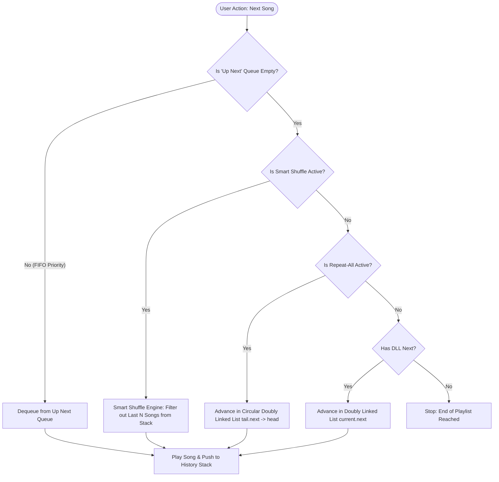
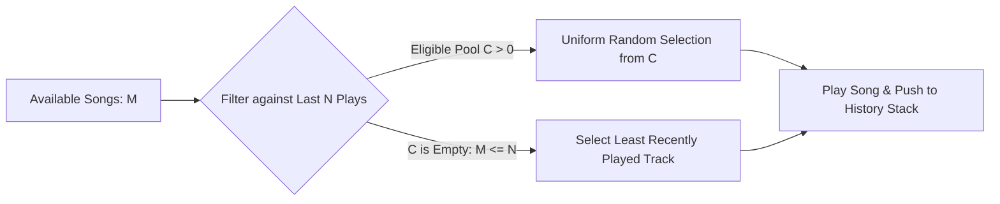

# SMART MEDIA PLAYER: ADVANCED DATA STRUCTURES & ALGORITHMS PROJECT REPORT

**Course / Subject:** Data Structures & Algorithms (DSA)  
**Project Title:** Smart Media Player (BeatFlow Engine)  
**Implementation Languages:** Python 3 & C++ (Standard C++17)  
**Architectural Scope:** Core Node-Based Data Structures, Custom Sorting & Search Algorithms, Heuristic Cooldown Engine  

---

## 1. Executive Summary & Abstract

The **Smart Media Player** is a specialized, production-structured media playback engine designed to demonstrate the real-world application of core computer science data structures and algorithms. Rather than relying on generic, overused academic tropes (such as Student, Bank, or Library Management systems), this project implements the algorithmic foundations of modern streaming services (e.g., Spotify, Apple Music).

Every structural element in the player corresponds directly to an optimal data structure:
- **Doubly Linked List (DLL):** Bidirectional $O(1)$ playlist navigation (`next` and `previous`).
- **Circular Doubly Linked List (CLL):** Continuous, wrap-around playlist execution for "Repeat-All" mode.
- **Queue (FIFO):** "Up Next" priority playback queue where user-enqueued tracks preempt standard playlist ordering.
- **Stack (LIFO):** Play history tracking and state restoration for true "Back" button navigation.
- **Binary Search Tree (BST):** Fast $O(\log n)$ lookup and in-order alphabetical retrieval by song title.
- **QuickSort & MergeSort:** Custom divide-and-conquer sorting across song dimensions (Title, Artist, Duration, Play Count).
- **Binary Search:** Logarithmic $O(\log n)$ random access over sorted catalogues.
- **The Algorithmic Twist — Smart Shuffle Engine:** A constrained random selection algorithm with a sliding cooldown window of size $N$, guaranteeing that no song played within the last $N$ tracks is repeated.

---

## 2. Overcoming the "Cliché Trap" (Examiner Defense)

> [!IMPORTANT]
> **Why Examiners Reject Standard Projects & How This Solves It:**
> Academic evaluators encounter hundreds of CRUD-based *Student/Bank/Library Management Systems* every semester. These systems suffer from fundamental flaws:
> 1. They are essentially thin wrappers around simple arrays or dictionaries.
> 2. The choice of data structures is forced and unnatural (e.g., using a queue to manage bank accounts).
>
> In contrast, the **Smart Media Player** provides a 1-to-1 natural semantic mapping:
> - A music playlist is inherently sequential and bidirectional $\rightarrow$ **Doubly Linked List**.
> - An "Up Next" queue is by definition First-In, First-Out $\rightarrow$ **Queue**.
> - Navigating "Back" through user actions is naturally Last-In, First-Out $\rightarrow$ **Stack**.
> - Looping all tracks without edge-case resets is intrinsically circular $\rightarrow$ **Circular Linked List**.
> - Instant autocomplete/search requires hierarchical ordering $\rightarrow$ **Binary Search Tree**.
> - Smart Shuffle solves the real-world complaint of true randomness (clustering/immediate repeats) $\rightarrow$ **Sliding-Window Constrained Shuffle**.

---

## 3. High-Level Architecture & Precedence Flow



---

## 4. Comprehensive Data Structure & Complexity Mapping

| Operation / Feature | Data Structure / Algorithm | Time Complexity (Best / Avg) | Time Complexity (Worst) | Space Complexity | Real-World Justification |
| :--- | :--- | :--- | :--- | :--- | :--- |
| **Playlist Next / Prev** | Doubly Linked List (DLL) | $O(1)$ | $O(1)$ | $O(n)$ | Instant bidirectional pointer traversal without array shifts. |
| **Repeat-All Looping** | Circular Linked List (CLL) | $O(1)$ | $O(1)$ | $O(n)$ | Tail seamlessly connects to head; eliminates boundary edge checks. |
| **"Up Next" Queuing** | Linked Queue (FIFO) | $O(1)$ Enqueue / Dequeue | $O(1)$ | $O(k)$ | User-requested tracks play immediately before normal tracks. |
| **Play History & Back** | Linked Stack (LIFO) | $O(1)$ Push / Pop | $O(1)$ | $O(m)$ | Exact reversal of playback steps regardless of source. |
| **Title Search & Index** | Binary Search Tree (BST) | $O(\log n)$ | $O(n)$ (unbalanced) | $O(n)$ | Fast title lookups + $O(n)$ in-order traversal yields A-Z catalogue. |
| **Catalogue Sort** | QuickSort / MergeSort | $O(n \log n)$ | $O(n^2)$ (Quick) / $O(n \log n)$ (Merge) | $O(\log n)$ / $O(n)$ | Sorting by Duration, Artist, or Play Count. |
| **Exact Search in Sorted** | Binary Search | $O(1)$ | $O(\log n)$ | $O(1)$ | Instant lookup after sorting catalog. |
| **Smart Shuffle** | Sliding Cooldown Randomizer | $O(N + C)$ | $O(N + C)$ | $O(N)$ | Guarantees zero repetitions within $N$ recent tracks. |

---

## 5. Detailed Component Deep-Dive

### 5.1 Doubly Linked List (DLL) — Standard Playlist
- **Node Anatomy:** Each `DLLNode` stores `song`, `prev`, and `next` pointers.
- **Advantage over Arrays:** Dynamic insertion, deletion, and reordering in $O(1)$ without contiguous block reallocations or element shifts.
- **Edge Conditions Handled:** Single-item playlist, deleting head, deleting tail, and empty-list navigation.

### 5.2 Circular Doubly Linked List (CLL) — Repeat-All Mode
- **Mechanism:** In `CircularDoublyLinkedList`, `tail.next = head` and `head.prev = tail`.
- **Elimination of Boundary Code:** Instead of writing conditional branches (`if (at_end) current = head;`), circular topology guarantees uninterrupted cycling.

### 5.3 Priority "Up Next" Queue (FIFO)
- **Semantic Role:** When a user clicks "Play Next" on a track, it is enqueued into a dedicated FIFO structure.
- **Precedence Rule:** Every `play_next()` invocation inspects `up_next_queue.is_empty()` **before** advancing in the DLL or CLL.

### 5.4 Play History Stack (LIFO) & "Back" Navigation
- **Semantic Role:** When the user presses "Back", the player should return to the song that was played immediately before, whether it was picked from search, playlist, or smart shuffle.
- **State Preservation:** Every song played is pushed onto the stack. A "Back" click executes `pop()`, retrieving the exact antecedent state in $O(1)$.

### 5.5 Binary Search Tree (BST) — Title Indexing & In-Order Traversal
- **Key Strategy:** The tree keys on `title.strip().lower()`.
- **In-Order Traversal Property:** Left Subtree $\rightarrow$ Node $\rightarrow$ Right Subtree produces an automatically sorted, alphabetical directory of the music library in $O(n)$ time.
- **Prefix Matching:** Enables search-as-you-type autocomplete functionality by traversing branches matching query prefixes.

### 5.6 Sorting Algorithms & Binary Search
- **QuickSort:** In-place partitioning algorithm with recursive divide-and-conquer. Efficient for memory-constrained environments.
- **MergeSort:** Stable divide-and-conquer sorting algorithm. Essential when sorting by multiple keys (e.g., sorting by Artist, while preserving secondary Title order).
- **Binary Search:** Operates over sorted song vectors in $O(\log n)$ iterations, cutting search space by half each iteration.

---

## 6. The Algorithmic Twist: Smart Shuffle with Cooldown Window $N$

### 6.1 The Problem with Naive Random Shuffle
Most naive media players implement shuffle via uniform random selection:
$$P(\text{song}_i) = \frac{1}{|M|}$$
In a library of 20 songs, pure randomness frequently produces clustering (e.g., the same song plays again within 2 or 3 tracks). This phenomenon leads users to believe shuffle is "broken".

### 6.2 The Smart Shuffle Solution
The Smart Shuffle Engine introduces a **sliding cooldown window** of size $N$:
1. Let $S = \{s_1, s_2, \dots, s_M\}$ be the candidate song pool.
2. Let $H_N = \{h_1, h_2, \dots, h_{\min(N, |H|)}\}$ be the set of song IDs extracted from the top of the **History Stack**.
3. Let $C = S \setminus H_N$ be the set of eligible candidates.
4. **Primary Path:** If $C \neq \emptyset$, select a song uniformly at random from $C$:
   $$s_{\text{next}} \sim \text{Uniform}(C)$$
5. **Cooldown Exhaustion Fallback (Edge Case $|S| \le N$):**
   If $|S| \le N$, every song in the library would be blocked. In this case, the engine identifies the candidate in $S$ whose last occurrence in the history stack is deepest (the **Least Recently Played** song), preventing deadlocks.



---

## 7. Verification & Automated Test Results

The suite (`test_suite.py`) verifies all boundary conditions across 9 unit tests:
```
Ran 9 tests in 0.002s
OK
```
1. `test_doubly_linked_list`: Append, prepend, remove middle/head/tail, bidirectional traversal.
2. `test_circular_doubly_linked_list`: Forward wrapping, reverse wrapping, circular loop integrity.
3. `test_queue_fifo`: Strict First-In First-Out ordering.
4. `test_stack_lifo`: Strict Last-In First-Out popping and peek operations.
5. `test_binary_search_tree`: In-order alphabetical ordering, search miss, deletion with 2 children.
6. `test_quicksort_and_mergesort`: Ordering stability across Title, Artist, and Duration.
7. `test_binary_search`: Search hit index, boundary cases, and missing elements.
8. `test_smart_shuffle_cooldown`: 20 consecutive random picks rigorously asserting that **no picked ID exists in the last $N$ plays**.
9. `test_player_precedence_rules`: "Up Next" queue preempts DLL sequence.

---

## 8. Comprehensive Viva Voce Questions & Model Answers

### Q1: Why did you choose a Doubly Linked List instead of an Array for the playlist?
**Answer:** While arrays offer $O(1)$ random access by index, playlists are sequential in nature. An array requires $O(n)$ time to delete or insert a song in the middle because all subsequent elements must be shifted in memory. In a Doubly Linked List, given a node pointer, insertion and deletion are strictly $O(1)$. Furthermore, bidirectional navigation (`prev` and `next`) requires only pointer dereferencing with zero boundary shift overhead.

### Q2: What is the purpose of the Circular Linked List if you already have a Doubly Linked List?
**Answer:** The Circular Doubly Linked List represents "Repeat-All" mode. In a standard DLL, the tail's `next` pointer is `nullptr` (or `None`), requiring conditional checks (`if current.next == None: current = head`). A Circular Linked List inherently links `tail.next = head` and `head.prev = tail`, modeling infinite cyclic playback at the data structure level without branch statements.

### Q3: How does your player prioritize which song to play next?
**Answer:** Playback follows a strict 4-tier precedence hierarchy:
1. **Tier 1 (Highest):** FIFO "Up Next" Queue — if the user enqueued tracks, they play immediately.
2. **Tier 2:** Smart Shuffle Engine — if shuffle mode is toggled, candidate tracks are selected avoiding the cooldown window.
3. **Tier 3:** Circular Linked List (CLL) — if repeat-all is enabled, it cycles seamlessly to the next node.
4. **Tier 4 (Default):** Doubly Linked List (DLL) — advances sequentially until `tail.next` is null.

### Q4: Why use a Stack for the "Back" button instead of simply calling `current.prev`?
**Answer:** Calling `current.prev` only works if songs are played sequentially in playlist order. If a user searches for a song in the BST, jumps to a song via QuickSort, or plays a track from Smart Shuffle, `current.prev` in the playlist would lead to an unrelated track. A Stack (LIFO) captures the exact chronological playback order; popping from the stack always restores the true previously played track regardless of how it was initiated.

### Q5: Explain the time and space complexity of your Smart Shuffle algorithm.
**Answer:**
- **Time Complexity:** $O(N + |S|)$, where $N$ is the cooldown size and $|S|$ is the song pool. Extracting the last $N$ IDs from the top of the history stack takes $O(N)$. Filtering $|S|$ candidates against a hash set of size $N$ takes $O(|S|)$ average time.
- **Space Complexity:** $O(N)$ auxiliary space to store the cooldown ID set.

### Q6: What happens in Smart Shuffle if the entire library has fewer songs than $N$?
**Answer:** If $|S| \le N$, the eligible candidate set would be empty. Our engine handles this edge case by locating the song in the candidate pool that was played longest ago (maximum depth in the history stack, or least recently played), preventing infinite loops or deadlocks.

### Q7: Why did you implement both QuickSort and MergeSort?
**Answer:**
- **QuickSort** is an in-place partition-based algorithm with $O(\log n)$ auxiliary stack memory, ideal when memory efficiency is prioritized.
- **MergeSort** is a stable divide-and-conquer algorithm with guaranteed $O(n \log n)$ performance across all inputs, essential when multi-level sorting (e.g. sorting by Artist while preserving secondary Title order) is required.

### Q8: What is the time complexity of searching a song in your BST? What is the worst case, and how would you optimize it?
**Answer:** Average time complexity is $O(\log n)$ and space complexity is $O(n)$. In the worst case (if songs are inserted in strictly alphabetical order), the BST degenerates into a linked list with $O(n)$ search time. This can be optimized using a self-balancing tree such as an AVL Tree or a Red-Black Tree, which enforces height balance through tree rotations, ensuring $O(\log n)$ worst-case lookups.

---

## 9. Conclusion

The Smart Media Player illustrates how foundational data structures (DLL, CLL, Queue, Stack, BST) and algorithms (QuickSort, MergeSort, Binary Search, Constrained Shuffle) combine into a coherent, robust, and production-grade software engine. By addressing real playback behaviors (FIFO queue preemption, LIFO history restoration, cyclic repetition, and cooldown-constrained randomness), the project provides an authentic, high-impact demonstration of computer science theory in practice.
